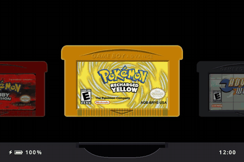

<div align="center">

# brickslot

A Game Boy-centric frontend for the TrimUI Brick Pro, forked from
[slot](https://github.com/BrandonKowalski/slot) by Brandon T. Kowalski.

<a href="LICENSE"></a>
<a href="CHANGELOG.md"></a>

</div>

---

# What is brickslot?

brickslot is slot, a bespoke, Game Boy-centric frontend for the Anbernic RG SP, ported to
run on the TrimUI Brick Pro as well. Everything that works on the Anbernics still does.

Has support for GBA, GBC, and GB titles only.

> [!IMPORTANT]
> ROMs must be unzipped. brickslot does not read `.zip` or `.7z` files.

slot's user guide at [slot-cfw.fyi](https://slot-cfw.fyi) applies to brickslot, apart from
TrimUI setup, which is covered below.

Release notes can be found in the [changelog](CHANGELOG.md).

---

# What does it look like?

<p align="center">


</p>

<p align="center">

</p>

---

# Supported Devices

| Device             | Supported                  | Since Version |
|--------------------|----------------------------|---------------|
| Anbernic RG SP     | Yes                        | Always        |
| Anbernic RG34XX    | Yes                        | 1.4.0         |
| Anbernic RG34XXSP  | Yes (No Stick Support Yet) | 1.4.0         |
| Anbernic RG35XXSP  | Yes                        | 1.5.0         |
| Anbernic 35XX Plus | Yes                        | 1.5.0         |
| Anbernic RG28XX    | Yes                        | 1.6.0         |
| TrimUI Brick Pro   | Yes (early, tested)        | Unreleased    |
| TrimUI Brick       | Untested port              | Unreleased    |

RG28XX support was contributed by [GamerAnim](https://github.com/GamerAnim). Its panel is mounted
portrait, so brickslot turns the picture onto it. If it comes out upside down, add `export SLOT_ROTATE=ccw`
to `System/launch_frontend.sh`.

## TrimUI Brick Pro

The Brick Pro (and the original Brick) run on TrimUI's stock firmware, the same way
MinUI and NextUI do: the stock OS runs `/mnt/SDCARD/.tmp_update/updater` at boot when it
exists, and brickslot's updater takes over from there.

1. Build the card tree with `task dist:trimui` (needs Docker on a non-arm64 host).
2. Copy everything in `dist-trimui/`, including the hidden `.tmp_update` folder, to the
   root of the Brick Pro's SD card. ROMs go in `Games/GBA`, `Games/GB` and `Games/GBC`.
3. Boot the device. To go back to stock, delete `.tmp_update` from the card.

What changes on TrimUI hardware:

- Sleep works like NextUI's deep sleep: a tap of power turns the screen off, and after
  three minutes asleep (not while charging) the Brick Pro suspends to RAM instead of
  powering off. Power wakes it straight back into the game.

- Buttons come from TrimUI's own `trimui_inputd` pad, which numbers its buttons
  differently from the Anbernics, and sends L2/R2 as analog triggers. brickslot spots the pad by
  name; `export SLOT_KEYMAP=anbernic` in the updater turns that off.
- The backlight is driven through `/dev/disp`, rumble through GPIO 227 (held to 2.5V on
  the Brick Pro, as NextUI does), and the battery LED colours the top light bar.
- The card is `/mnt/SDCARD`, and brickslot leaves the boot logo alone.
- The 1024x768 panel is 4:3, so the same 640x480 bezel art fits it.

## Saves

Quick menu > Gameplay > **Save Format** picks how in-game (battery) saves are written:

- **RetroArch (.srm)**, the default: `Saves/GBA/<game>.srm`, plus `<game>.rtc` for Game
  Boy carts with a clock. RetroArch, NextUI and other RetroArch-based firmware load these,
  and theirs load here.
- **slot (.sav)**: one `<game>.sav` with the clock on the end, as the original slot writes.

Either way both kinds are read. If a game has both, say one copied over from another
device, the newer file wins. Switching the setting converts each game the next time it
saves, and the files in the old format are kept as `.bak`.

## Extras borrowed from NextUI and NX Redux

These live in the quick menu (tap MENU on the shelf).

- **Saves put on the card**: a save copied in from another device or a backup is noticed when the game goes in, which then starts from it instead of where it was left. **Restart** on the Home panel (press A twice) does the same by hand.
- **Customize** (**X** on the shelf): pick the selected game's cart material (Default, Opaque, Clear, Glitter) and colour from a grid, seen on the cart as you go. B closes and keeps it in `Config/cart_shell.txt`.
- **Clock** (Settings > Screen > Clock): 24-hour or 12-hour time with AM/PM.
- **Socket style** (Settings > Screen > Style): a light, dotted carousel after the Socket frontend, with the selected cart swaying in 3D between greyed neighbours, the game's name on a pill and the controls along the bottom. Set in Inter (SIL Open Font License, `crates/slot-ui/assets/Inter-SemiBold.ttf.OFL.txt`).
- **Home panel** (**Home** on the Brick Pro, **MENU+Y** on devices without a Home button, on the shelf or in a game): quick toggles for screenshot, sound, rumble, Wi-Fi, lights and power, brightness and volume sliders, and live temperature, CPU clock, memory and battery. The game pauses while it is up; **B** or **Home** resumes, **MENU** on the shelf opens settings.
- **Search Games** (or **Y** on the shelf): type part of a name on the on-screen keyboard
  (D-pad to move, A to type, B to delete). Matching games from every shelf are listed as
  you type, ignoring accents and capitals. L/R picks one and START takes you to its cart.
- **Lights** (TrimUI): show the battery state on the top bar, light every zone in one
  colour, or turn them all off. Color, effect (Static, Breathe, Blink, Rainbow, Rainbow
  Wave, Fire, Ocean, Aurora, Sunset, Candy, Police, Heartbeat) and
  brightness each have a row. On Anbernics with an RGB LED, Color sets it too.
- **Screen > Brightness / Warmth**: the same levels as SELECT + D-pad. MENU held with
  VOL+ / VOL- also steps brightness, as on NextUI.
- **Play time**: every game counts how long it has been played, in `Config/playtime.txt`,
  and says so as it starts ("Played 3h 05m").
- **Network > Wi-Fi**: joins the networks you saved in TrimUI's own Wi-Fi menu. To add
  one by hand, put `ssid = ...` and `password = ...` lines in `Config/wifi.txt`. Link play
  borrows the radio and gives it back afterwards.
- **Network > File Transfer**: a web page at the address the banner shows
  (`http://<ip>:8080`) for uploading and downloading games, saves, states, labels,
  screenshots and BIOS files from a computer or phone on the same Wi-Fi. It only reaches
  those folders, has no password, and is off again after every restart.
- **Network > Download Labels**: fetches box art from the libretro thumbnail collection for
  every game with no label yet (official games mostly; ROM hacks usually are not there).
  Restart to see them.
- **Gameplay > Performance**: Default (as the system set it), Battery Saver (up to 1.2 GHz)
  or Performance (flat out).
- **Screenshots**: MENU + A in a game saves the picture to `Screenshots/`.
- **Network > Set Time Automatically** (on by default): once Wi-Fi connects, the clock is
  set from an internet time server. Your time zone stays the one picked under Date & Time.
- **Network > Syncthing**: runs Syncthing so saves and states sync with your computer or
  another handheld. Once Wi-Fi is up a banner shows the address of its web page
  (`http://<ip>:8384`); share `Saves/` and `States/` from there. Its settings live in
  `Config/syncthing`. Set a GUI password on that page, since it is open to your network.
- **Network > RetroAchievements**: put your account in `Config/retroachievements.txt`:

  ```
  username = yourname
  password = yourpassword
  ```

  After the first login brickslot swaps the password for the token the server hands back,
  so the password does not stay on the card. Games are matched by the MD5 of the ROM,
  as RetroAchievements does for Game Boy and GBA. Achievements run in softcore, so save
  states, rewind and fast forward keep working, and each unlock pops up in a banner.

If brickslot exits on its own three times in a row within a minute of starting, the updater
powers the device off instead of looping. Check `slot.log` and `slot-session.log` on the card.

If you have one of the untested devices, or have tried brickslot on a device not listed,
please [open an issue on GitHub](https://github.com/davidtpb/BrickSlot/issues) and say how it went.

---

# AI Disclosure

The Rust frontend was put together by Claude Opus. I reviewed everything that was
produced. All documentation is 100% free-range, meatbag prose.

The project is extremely low stakes. I wanted a bespoke frontend for my RG SP and thought
that something that evokes the feeling of using my GBA SP as a kid would be pretty neat.

Use it, don't use it, I don't care.

Figured I should share the end result of all the wasted water. ✌🏻
